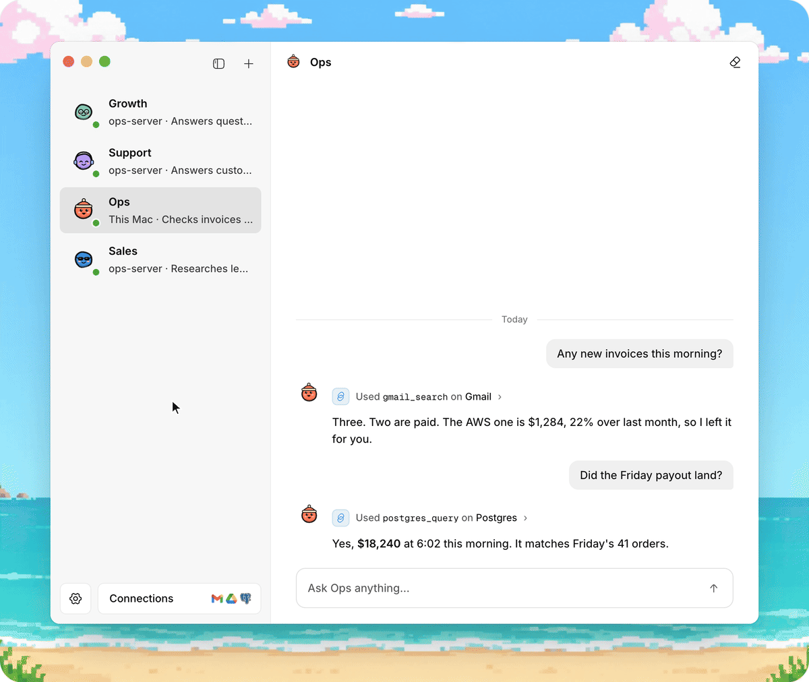
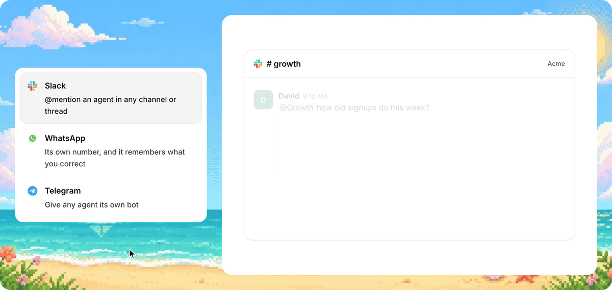
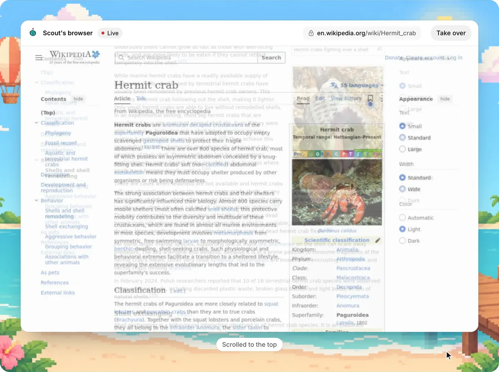

<h1>OpenHut</h1>

<b>Build, manage & share agents with your team</b>

Self-improving agents in Slack and WhatsApp, on your own server.

<a href="https://openhut.dev/download/mac?from=github"><picture><source media="(prefers-color-scheme: dark)" srcset="docs/readme/buttons/mac-dark.png"></picture></a>
<a href="https://openhut.dev/download/linux?from=github"><picture><source media="(prefers-color-scheme: dark)" srcset="docs/readme/buttons/linux-dark.png"></picture></a>
<a href="https://openhut.dev/docs"><picture><source media="(prefers-color-scheme: dark)" srcset="docs/readme/buttons/start-dark.png"></picture></a>

## Meet your team where they work

Every agent gets its own Slack app, WhatsApp number and Telegram bot.

## Agents that browse the web

Watch them work live. Take over when a site needs a login.

## Where your agents live

On your Mac, or on your own server. Each agent in its own sealed box.

## How it compares

<table>
<tr>
<th></th>
<th align="center"><a href="https://github.com/openhuthq/openhut"> OpenHut</a></th>
<th align="center"><a href="https://github.com/openclaw/openclaw"> OpenClaw</a></th>
<th align="center"><a href="https://github.com/DuskBotAI/duskbot"> DuskBot</a></th>
<th align="center"><a href="https://github.com/NousResearch/hermes-agent"> Hermes</a></th>
</tr>
<tr><td>Each agent sandboxed by default</td><td align="center">✓</td><td align="center">✗</td><td align="center">✗</td><td align="center">✗</td></tr>
<tr><td>Slack, WhatsApp and Telegram</td><td align="center">✓</td><td align="center">✓</td><td align="center">✗</td><td align="center">✓</td></tr>
<tr><td>Learns skills and memories as it works</td><td align="center">✓</td><td align="center">✓</td><td align="center">✓</td><td align="center">✓</td></tr>
<tr><td>Open source, free for commercial use</td><td align="center">✓</td><td align="center">✓</td><td align="center">✗</td><td align="center">✓</td></tr>
</table>

## Free, open source

[MIT](LICENSE)
