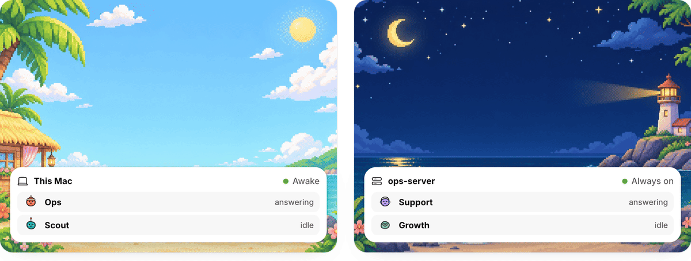
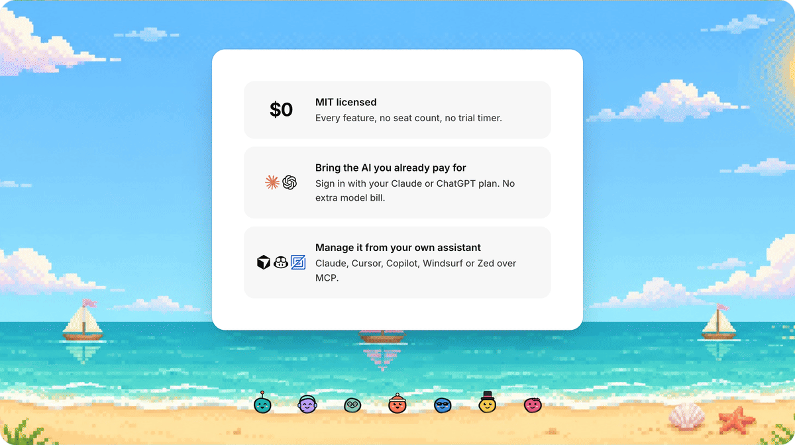

<h1>OpenHut</h1>

<b>Build, manage & share agents with your team</b>

Self-improving agents in Slack and WhatsApp, on your own server.

<a href="https://openhut.dev/download/mac?from=github"><picture><source media="(prefers-color-scheme: dark)" srcset="docs/readme/buttons/mac-dark.png"></picture></a>
<a href="https://openhut.dev/download/linux?from=github"><picture><source media="(prefers-color-scheme: dark)" srcset="docs/readme/buttons/linux-dark.png"></picture></a>
<a href="https://openhut.dev/docs"><picture><source media="(prefers-color-scheme: dark)" srcset="docs/readme/buttons/start-dark.png"></picture></a>

## Meet your team where they work

Its own Slack app and Telegram bot, and on an always-on computer you add, its own WhatsApp number.

## Agents that browse the web

On an always-on computer you add, watch them work live. Take over any time.

## Where your agents live

On your Mac or PC, or on your own server. On Linux, each agent is sealed in its own box.

<table>
<tr>
<th></th>
<th align="center"></th>
<th align="center"></th>
<th align="center"></th>
<th align="center"></th>
</tr>
<tr><td>Each agent sealed in its own box (on Linux)</td><td align="center">✓</td><td align="center">✗</td><td align="center">✗</td><td align="center">✗</td></tr>
<tr><td>Data keys stay in a gateway</td><td align="center">✓</td><td align="center">✗</td><td align="center">✗</td><td align="center">✗</td></tr>
<tr><td>Slack, WhatsApp, Telegram</td><td align="center">✓</td><td align="center">✓</td><td align="center">✗</td><td align="center">✓</td></tr>
<tr><td>MIT open source</td><td align="center">✓</td><td align="center">✓</td><td align="center">✗</td><td align="center">✓</td></tr>
</table>

OpenHut, OpenClaw, DuskBot and Hermes Agent on its own, as each ships by default. OpenHut runs Hermes Agent inside each sandbox.

## Free, open source

