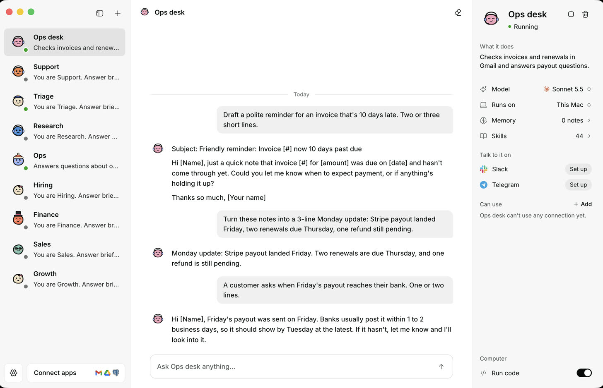
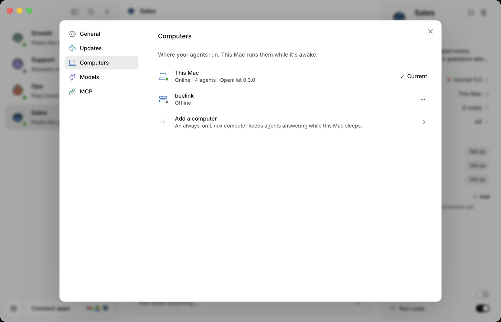

<div align="center">

<h1>OpenHut</h1>

<p><b>Build, manage & share agents with your team</b></p>

<p>Self-improving agents in Slack and WhatsApp, on your own server.</p>

<p>
<a href="https://openhut.dev/download/mac?from=github"><b>Download for Mac</b></a> &nbsp;·&nbsp;
<a href="https://openhut.dev/download/linux?from=github"><b>Download for Linux</b></a> &nbsp;·&nbsp;
<a href="https://openhut.dev/docs">Docs</a>
</p>

<p><a href="LICENSE"></a></p>

</div>



## Install

- **Mac:** [download the app](https://openhut.dev/download/mac?from=github). Apple silicon, macOS 14 or later.
- **Linux:** [download the AppImage](https://openhut.dev/download/linux?from=github), or the [.deb](https://github.com/openhuthq/openhut/releases/latest/download/openhut-x64.deb) for Debian and Ubuntu. x64, with Docker.
- **An always-on server:** add it from the app, under **Settings › Computers**. The app installs OpenHut on it over Tailscale SSH. See [Computers](https://openhut.dev/docs/computers).

Open it, sign in to a model under **Settings › Models**, and make an agent. No account.

## What you get

- **One agent per job, each in your team's chat.** Each agent is its own Slack app, its own WhatsApp number and its own Telegram bot.
- **Sealed.** Each agent runs in its own sandbox: a microVM on a Mac, gVisor on Linux. It can't reach another agent, your computer or your LAN.
- **A gateway that holds every key.** Agents reach Postgres, Linear, GitHub, Google and any MCP server only through it. It checks each call against what you allowed and logs it.
- **Powered by [Hermes](https://github.com/NousResearch/hermes-agent).** Agents learn skills and keep memories as they work. Correct one once, in chat, and it remembers.
- **More computers.** Add Linux computers over [Tailscale](https://tailscale.com) so agents keep answering while your Mac sleeps, and move an agent between them with its memory, skills and chats.
- **Manage it from the app, or from your own AI** (Claude Code or any MCP app) over the control MCP.
- **Your models.** Claude and Codex subscriptions, or OpenRouter, OpenAI and xAI keys.



## How it compares

| | OpenHut | [OpenClaw](https://github.com/openclaw/openclaw) | [DuskBot](https://github.com/DuskBotAI/duskbot) | [Hermes](https://github.com/NousResearch/hermes-agent) alone |
| --- | --- | --- | --- | --- |
| Isolation | Each agent in its own microVM (Mac) or gVisor sandbox (Linux) | Agent on the host; a Docker sandbox for tools, off by default | Local bots in Docker, Podman or Apple `container`, or on the host | On the host by default |
| Team channels | Each agent its own Slack app, WhatsApp number and Telegram bot | Slack, WhatsApp, Telegram and more, through one gateway | Chat in its own app | Slack, WhatsApp, Telegram and more, through one gateway |
| License | MIT | MIT | Source-available, free for personal use only | MIT |

## Docs

[openhut.dev/docs](https://openhut.dev/docs): install, Slack, WhatsApp, Telegram, connections, computers, MCP and security.

## Develop

Node 22.18 or newer.

```sh
npm install
npm run dev
```

Then open `http://localhost:5173`. How the repo is laid out, the conventions and the checks: [CONTRIBUTING.md](CONTRIBUTING.md) and [CLAUDE.md](CLAUDE.md).

## License

[MIT](LICENSE)
